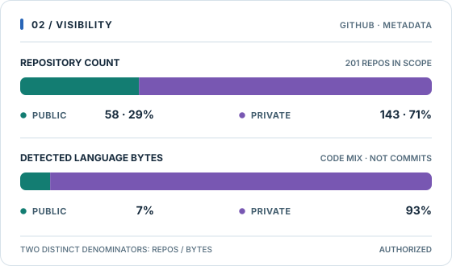
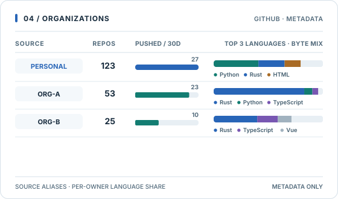

<div align="" style="overflow: hidden;">

# 👋 Hi, I’m Ricky.

🎯 **Background**: Former AAM backend developer | Current Data Analyst  
📚 **Hobbies**: Reading, Programming, Exploring system architectures  
🚀 **Tech Stack**: Python · Rust · Golang/Java  
🧠 **Learning Now**: Rust · Golang/Java · Data Visualization · Cloud Infrastructure

---

## 🌐 Cloudflare-Based Mirrors
### 📦 PyPI Mirror

```bash
pip install -i https://pip.pylab.me <package>
```

---

</div>

## Engineering footprint

<!-- PROFILE_METRICS:CARDS:START -->
<table width="100%" align="center">
  <tr>
    <td width="50%" align="center">
      <picture>
        <source media="(prefers-color-scheme: dark)" srcset="https://raw.githubusercontent.com/swoiow/swoiow/main/assets/metrics/overview-dark.svg?v=3d032d3ea8aa" />
        
      </picture>
    </td>
    <td width="50%" align="center">
      <picture>
        <source media="(prefers-color-scheme: dark)" srcset="https://raw.githubusercontent.com/swoiow/swoiow/main/assets/metrics/visibility-dark.svg?v=9b76db08a20c" />
        
      </picture>
    </td>
  </tr>
  <tr>
    <td width="50%" align="center">
      <picture>
        <source media="(prefers-color-scheme: dark)" srcset="https://raw.githubusercontent.com/swoiow/swoiow/main/assets/metrics/languages-dark.svg?v=8d3f1b75e0ad" />
        
      </picture>
    </td>
    <td width="50%" align="center">
      <picture>
        <source media="(prefers-color-scheme: dark)" srcset="https://raw.githubusercontent.com/swoiow/swoiow/main/assets/metrics/organizations-dark.svg?v=3ba85e2a0bda" />
        
      </picture>
    </td>
  </tr>
</table>
<!-- PROFILE_METRICS:CARDS:END -->

<sub>Updated daily by a centralized GitHub App. These cards use repository metadata only; private repository names and code histories are not published. Languages represent GitHub-reported language bytes, not commit contributions. Recent activity refers to repository `pushed_at` timestamps, not author commits. Commit, PR, Issue and Review collection remains on hold. Statistics include only repositories authorized to the Reader App; scheduled updates are best-effort.</sub>
