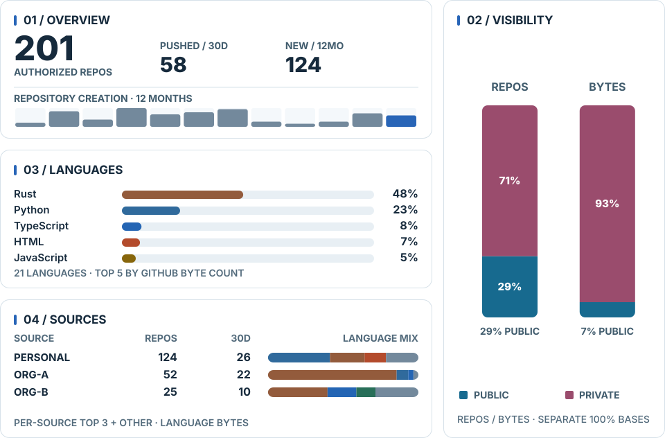

# 👋 Hi, I’m Ricky.

🎯 **Background**: Former AAM backend developer | Current Data Analyst  
📚 **Hobbies**: Reading, Programming, Exploring system architectures  
🚀 **Tech Stack**: Python · Rust · Golang/Java  
🧠 **Learning Now**: Rust · Golang/Java · Data Visualization · Cloud Infrastructure

---

## 🌐 Cloudflare-Based Mirrors
### 📦 PyPI Mirror

```bash
pip install -i https://pip.pylab.me <package>
```

---


## Engineering footprint

<!-- PROFILE_METRICS:CARDS:START -->
<p align="center">
  <picture>
    <source media="(max-width: 600px) and (prefers-color-scheme: dark)" srcset="https://raw.githubusercontent.com/swoiow/swoiow/main/assets/metrics/dashboard-mobile-dark.svg?v=e91321cf01dd" />
    <source media="(max-width: 600px)" srcset="https://raw.githubusercontent.com/swoiow/swoiow/main/assets/metrics/dashboard-mobile-light.svg?v=86ec9bfa3cf7" />
    <source media="(prefers-color-scheme: dark)" srcset="https://raw.githubusercontent.com/swoiow/swoiow/main/assets/metrics/dashboard-desktop-dark.svg?v=d6648e84ca2e" />
    
  </picture>
</p>
<!-- PROFILE_METRICS:CARDS:END -->

### About these metrics

- **Coverage:** Only repositories authorized to the Reader App are counted; private repository names and source contents are not published.
- **Languages:** GitHub-reported language bytes, not commit contributions.
- **Activity:** Based on each repository's `pushed_at` timestamp, not the author's commit history.
- **Updates:** Refreshed daily on a best-effort basis. Commit, PR, Issue, and Review statistics are not collected.
